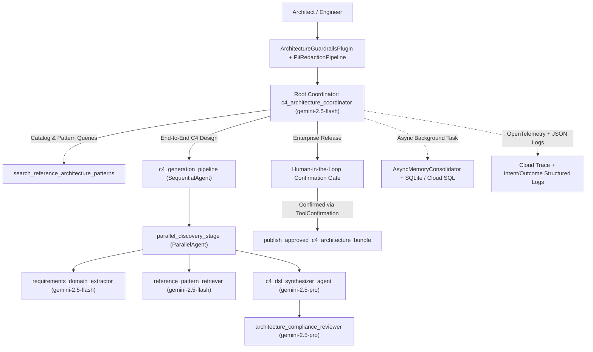

# C4 Model Architecture Creator Agent (`c4_architect_agent`)

Enterprise Multi-Agent System built with the **Google Agent Development Kit (`google-adk`)** and **Vertex AI Gemini 2.5** that transforms stakeholder requirements into validated **C4 Model** software architectures (**Level 1 System Context**, **Level 2 Containers**, **Level 3 Components**, **Level 4 Code/Interfaces**), complete **Mermaid C4** & **Structurizr DSL** workspaces, **Architecture Decision Records (ADRs)**, and **Well-Architected compliance audits**.

---

## Problem & Solution

- **Problem**: Designing consistent, security-vetted C4 software architectures across engineering teams is slow and error-prone—diagrams drift from governance standards, omit transport/encryption protocols, miss ADRs, and lack automated compliance verification.
- **Solution**: `c4_architect_agent` coordinates specialized ADK sub-agents (combining `ParallelAgent` discovery and `SequentialAgent` synthesis + verification) with strategic `Flash`/`Pro` model routing, persistent session & vector memory, OpenTelemetry distributed tracing, active PII redaction, and Human-in-the-Loop (HITL) approval gates before publishing enterprise baselines.

---

## Multi-Agent Architecture



---

## AgentOps Rubric Traceability Matrix (95 / 95 Points)

| Category | Criterion (5 pts each) | Implementation File & Evidence |
| :--- | :--- | :--- |
| **1. Tool & Interface Design** | Comprehensive Tool Docstrings | `c4_architect_agent/tools/c4_modeling_tools.py`, `c4_architect_agent/tools/governance_tools.py` (Google-style `Args`/`Returns` docstrings on all 6 tools) |
| | Descriptive Naming | `extract_c4_entities_from_requirements`, `search_reference_architecture_patterns`, `generate_c4_mermaid_and_structurizr_dsl`, `validate_c4_architecture_compliance`, `record_architecture_decision_record`, `publish_approved_c4_architecture_bundle` |
| | Explicit JSON Schemas | `c4_architect_agent/schemas/c4_schemas.py` (`C4ArchitectureSpecInput`, `C4DiagramBundleOutput`, `ComplianceReportOutput`, `AdrRecordInput`, `PublishBundleInput` with `extra="forbid"`) |
| | Guided Error Handling | `_guided_error(...)` & `GuidedToolError` in `c4_architect_agent/tools/c4_modeling_tools.py` returning `recovery_instructions` and `invalid_fields` without crashing |
| **2. Context & Memory** | Robust System Instructions | `c4_architect_agent/prompts/constitution.py` (`SHARED_ARCHITECTURAL_CONSTITUTION` + role-specific constitutions with persona, C4 domain laws, and constraints) |
| | History Compaction | `EventsCompactionConfig` + `ContextCacheConfig` on `App` in `c4_architect_agent/agent.py` and `HistoryCompactionEngine` in `c4_architect_agent/memory/compaction.py` |
| | Persistent Session State | `build_persistent_session_service` (`DatabaseSessionService` with SQLite / Cloud SQL PostgreSQL) + `PersistentArchitectureKnowledgeStore` vector search in `c4_architect_agent/memory/persistent_store.py` |
| | Async Memory Operations | `AsyncMemoryConsolidator` (`asyncio.create_task` background worker) + `AsyncMemoryConsolidationPlugin` in `c4_architect_agent/memory/async_consolidator.py` |
| **3. Orchestration & Logic** | Multi-Agent Patterns | `LlmAgent` Coordinator + `SequentialAgent` (`c4_generation_pipeline`) + `ParallelAgent` (`parallel_discovery_stage`) in `c4_architect_agent/agent.py` |
| | Strategic Model Routing | `StrategicModelRouter` & `ModelRoutingPlugin` routing `gemini-2.5-flash` vs. `gemini-2.5-pro` in `c4_architect_agent/orchestration/model_router.py` |
| | Guardrails & Policy Plugins | `ArchitectureGuardrailsPlugin` (prompt-injection shield, tool payload policy, and C4 output self-evaluation) in `c4_architect_agent/orchestration/guardrails_plugin.py` |
| | Human-in-the-Loop Hooks | `FunctionTool(..., require_confirmation=requires_publication_approval)` + `verify_or_request_human_confirmation` (`tool_context.request_confirmation`) in `c4_architect_agent/orchestration/hitl_confirmation.py` |
| **4. Observability & Tracing** | Structured JSON Logging | `CloudStructuredJsonFormatter` & `log_structured_event` in `c4_architect_agent/observability/structured_logger.py` (zero `print()` statements) |
| | Intent vs. Outcome Capture | `IntentOutcomeAuditPlugin` recording correlated `INTENT` (pre-execution) and `OUTCOME` (post-execution + `latency_ms`) logs in `c4_architect_agent/observability/audit_plugin.py` |
| | Distributed Tracing | OpenTelemetry `TracerProvider`, `CloudTraceSpanExporter`, and `start_traced_span` in `c4_architect_agent/observability/tracing.py` |
| | PII Redaction | `PiiRedactionPipeline` (Google Cloud DLP API + deterministic regex/Luhn scrubbing for emails, SSNs, CPFs, cards, phones, tokens) in `c4_architect_agent/observability/pii_redactor.py` |
| **5. Infrastructure & CI/CD** | Automated Evaluation Suites | `evaluations/c4_architect_golden.evalset.json`, `evaluations/test_config.json`, `evaluations/run_offline_eval.py`, and `tests/` |
| | Infrastructure as Code | `terraform/` (`main.tf`, `variables.tf`, `outputs.tf`, `versions.tf`), `Dockerfile`, and `.github/workflows/{ci.yml,deploy.yml}` |
| | Secure Secret Management | `SecretManagerResolver` (`google-cloud-secret-manager`) in `c4_architect_agent/config/secrets.py` + Secret Manager bindings in `terraform/main.tf` |

---

## Quickstart & ADK CLI Usage

### 1. Install Dependencies

```bash
python3 -m venv .venv
source .venv/bin/activate
pip install -e ".[dev]"
cp .env.example .env
```

### 2. Run Locally with Google ADK CLI (`adk`)

```bash
# Interactive terminal session
adk run c4_architect_agent

# Launch the ADK Web Developer UI (inspect multi-agent graph, events, and traces)
adk web .

# Execute ADK Evaluation against the Golden Dataset
adk eval c4_architect_agent evaluations/c4_architect_golden.evalset.json \
  --config_file_path=evaluations/test_config.json
```

### 3. Run Automated Tests & Offline Golden Regression Suite

```bash
pytest -v
python -m evaluations.run_offline_eval
```

---

## Cloud Deployment (ADK CLI & Terraform IaC)

### Option A: Deploy to Vertex AI Agent Engine or Cloud Run via ADK CLI

```bash
# Deploy directly to Vertex AI Agent Engine
adk deploy agent_engine \
  --project="${GOOGLE_CLOUD_PROJECT}" \
  --region="${GOOGLE_CLOUD_LOCATION}" \
  --display_name="C4 Model Architecture Creator Agent" \
  c4_architect_agent

# Or deploy containerized API server to Google Cloud Run
adk deploy cloud_run \
  --project="${GOOGLE_CLOUD_PROJECT}" \
  --region="${GOOGLE_CLOUD_LOCATION}" \
  --service_name="c4-architect-agent" \
  c4_architect_agent
```

### Option B: Provision Production Infrastructure with Terraform

```bash
cd terraform
terraform init
terraform plan \
  -var="project_id=${GOOGLE_CLOUD_PROJECT}" \
  -var="region=us-central1" \
  -var="container_image=us-central1-docker.pkg.dev/${GOOGLE_CLOUD_PROJECT}/c4-architect-agent-images/c4-architect-agent:v1.0.0"
terraform apply
```

---

## Repository Layout

```text
.
├── c4_architect_agent/          # Root ADK agent package (`root_agent`, `app`)
│   ├── agent.py                 # Coordinator + SequentialAgent + ParallelAgent + App
│   ├── config/                  # Typed settings & Google Cloud Secret Manager resolver
│   ├── memory/                  # DatabaseSessionService, Vector Store, Compaction, Async Worker
│   ├── observability/           # Structured JSON Logger, Intent/Outcome Plugin, OTel, PII DLP
│   ├── orchestration/           # Strategic Model Router, Guardrails Plugin, HITL Confirmation
│   ├── prompts/                 # Agent Constitutions & C4 domain laws
│   ├── schemas/                 # Strict Pydantic v2 JSON Schemas
│   └── tools/                   # C4 L1-L4 Mermaid/Structurizr DSL & Governance tools
├── evaluations/                 # ADK `.evalset.json` golden dataset & regression runner
├── tests/                       # Unit, integration, security, and observability tests
├── terraform/                   # Terraform IaC (Cloud Run, Cloud SQL, Secret Manager, IAM)
├── .github/workflows/           # Automated CI test/eval gate & keyless WIF deployment
├── Dockerfile                   # Non-root multi-stage container image
└── pyproject.toml               # Package dependencies & tooling config
```
